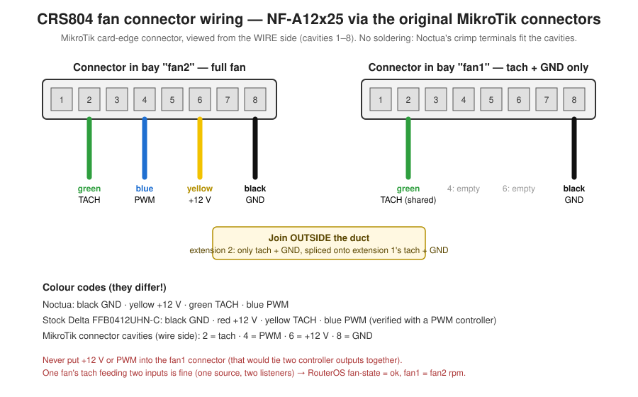

# Quiet MikroTik CRS804-4DDQ: one Noctua NF-A12x25 instead of the 2 × 40 mm Delta fans

> **DRAFT — not published yet.** Photos to be added (see `docs/photos/` TODO list at the end).

The CRS804-4DDQ (4 × 400G, popular for clustering NVIDIA DGX Spark / GB10 boxes) cools its switch chip with two
40 × 40 × 28 mm Delta FFB0412UHN fans (18,500 rpm, 58.5 dB(A) at full speed). They are loud, and RouterOS can only
bend the fan curve a little (`fan-full-speed-temp` is capped at 65 °C).

This mod replaces both fan modules with **3D-printed plugs that slide into the fan bays like the original hot-swap
carriers**, ducting both bays into **one 120 mm Noctua NF-A12x25 PWM** tilted 45° behind the switch.
The fan plugs into the **original MikroTik connectors**, so **RouterOS still controls its speed and monitors it**
(`fan-state=ok`). No soldering on the switch, fully reversible.

## Results (same switch, same room, AC off)

| Room temperature | 2 × Noctua NF-A4x20 (full speed, in the bays) | **NF-A12x25 adapter** (RouterOS-controlled) |
|---|---|---|
| ~30 °C | switch chip 60–61 °C | **54–55 °C** |
| 30–32.6 °C | 61–63 °C | **55–56 °C** |
| 32.7–35.4 °C | 63–65 °C | **55–57 °C** (fan at its ~2,040 rpm max) |

- A full warm day (room up to 34.9 °C, AC off): switch chip **peak 57 °C**, fan near-silent at night (~1,300 rpm) and
  at its quiet full speed in the afternoon.
- For reference, the stock Deltas held the chip at 56–59 °C only by running 4,500–9,500 rpm with periodic bursts to
  ~16,000 rpm ("take-off" noise).
- 200G links unaffected (0 FEC corrections at 65 °C during earlier tests).
- Measured with the switch's own sensors (SNMP / `/system/health`), living-room thermostat as ambient.

## What you need

| Item | Qty | Notes |
|---|---|---|
| Printed Part A — in-bay plugs + flange | 1 | `cad/v4.9_partA_detent.*` (clicks into the bays' latch notch) or `_smooth` (friction fit) |
| Printed Part B — plenum + 45° fan plate | 1 | `cad/v4.9_partB_plenum.*` |
| Printed Part C — cable grommet | 1 | `cad/v4.9_partC_grommet.*` |
| Noctua NF-A12x25 PWM | 1 | its spare 4-pin extension cable is used for the wiring |
| 2nd 4-pin fan extension (or a short 2-wire lead) | 1 | for the tach-only branch |
| Original MikroTik fan connectors | 2 | unscrewed from the two stock fan modules (keep the modules to go back) |
| M3 × 4 × 5 heat-set inserts (OD 5) | 4 | connector standoffs (bore 4.6 × 5 deep) |
| M3 × 6 screws | 4 | connector ears → inserts (ear thickness + ~3.5 mm) |
| M3 screws | 4 | Part B → Part A flange (A has 2.9 mm pilots for self-tapping or inserts) |
| Mini cable tie 2.5 mm, solder-seal sleeves | 1 + 2 | cable anchor at the plenum inlet (keeps the cable away from the fan); the tach join |

## Printing (tested on a Bambu Lab X1C)
- PETG works; ASA if it will sit in warm exhaust for years. 3–4 walls.
- **A:** flange on the bed, plugs up. **B:** the small rectangular flange on the bed. **C:** lip down. No supports.
- The plugs are modelled at the **exact** carrier size (43.23 × 40.65 × 44.19 mm). On an X1C that fitted perfectly; an
  earlier version with −0.1 mm/side was loose. Other printers may need `FDM=0.03 FDM_H=0.03` (see `cad/adapter.py`).

## Assembly
1. Power the switch off (or work fast: with no fan the chip passed 72 °C within ~3 minutes in testing).
2. Unscrew the MikroTik card-edge connector from each stock fan module (2 screws through its ears).
3. Press the 4 inserts into Part A's standoffs (they sit 37 mm in from the outer end — where the Delta's face was —
   so the connector ends up exactly where the carrier held it). Screw a connector onto each plug's standoffs.
4. Wire the connectors (see below), route the cables along the plug floors and out through Part B's
   keyhole port (right side as you look at the fan), seal with Part C.
5. Slide Part A into the bays (the detent clicks), bolt Part B on, mount the NF-A12x25 pulling air **out** of the switch.

## Wiring — no soldering on the switch side


Noctua's crimp terminals fit the MikroTik connector's cavities. Take the terminals out of the Noctua extension's
female plug and push them into the connector:

- **"fan2" connector (full):** black (GND) → cavity 8, yellow (+12 V) → 6, blue (PWM) → 4, green (tach) → 2.
- **"fan1" connector (tach only):** green (tach) → 2, black (GND) → 8. **Leave 4 and 6 empty.**
  The tach-only lead is joined to the main extension's tach + GND **outside** the duct (solder-seal sleeves).
  One fan's tach feeding both inputs is fine (one source, two listeners) — this is what makes RouterOS report
  `fan-state=ok` instead of "fail".
- Colours differ! Noctua: black GND · yellow +12 V · green tach · blue PWM.
  Stock Delta: black GND · red +12 V · **yellow tach · blue PWM** (the reverse of what many assume — verified).
- Common mistake: Noctua **blue** in cavity 2 → fan1 reads 0 rpm (blue is PWM).

## RouterOS settings
See `routeros/fan-settings.rsc`:
```
/system/health/settings/set fan-min-speed-percent=40 fan-target-temp=55 fan-full-speed-temp=65
```
- The default 12 % minimum runs the A12x25 at ~270 rpm → the chip overheats, the fan jumps to full speed, repeat.
- Needs RouterOS 7.25+ (10 s control loop; older 30 s loop overshoots).
- Never set target = full-speed temp (65): it saw-tooths.

## Design notes
- Nothing goes below 3 mm above the desk, so the switch stands on its own feet.
- Plugs are closed tubes at the measured carrier size; the 3.4 mm bay partition slides between them; the divider runs
  flush to the plenum face. Standoffs are faired along the flow; the only tie anchor is at the plenum inlet, holding the cable along the wall away from the fan blades.
- Detent bump 1.5 mm, 2.5 mm from the outer end, on the left rail (as seen from behind the switch), 45° ramps both ways
  so it clicks in and pulls out.
- Everything is parametric: `cad/adapter.py` (build123d 0.13). `cad/check.py` audits meshes (watertight, overhangs).

## Caveats
- One unit, one room. Tested up to a 34.9 °C room; hotter rooms will run the chip higher with the fan already at max.
- No fan redundancy: if the A12x25 dies, RouterOS reports it (both inputs read 0), but nothing cools the chip —
  alert on it. A higher-pressure 120 mm fan (e.g. Noctua NF-F12 iPPC-2000/3000 PWM) is a drop-in if you need margin.
- Hot-swap fan modules are designed to be removed; keep them to go back. Not affiliated with MikroTik or Noctua;
  use at your own risk.

## License
TBD (suggestion: CC BY-SA 4.0 for the models, MIT for the scripts).

## Photos TODO
1. Whole setup on the desk (switch + adapter + tilted fan) 2. Part A alone + connector on the standoffs
3. Noctua terminals in the MikroTik connector + the outside tach join 4. Cable port with grommet 5. Stock module vs plug
